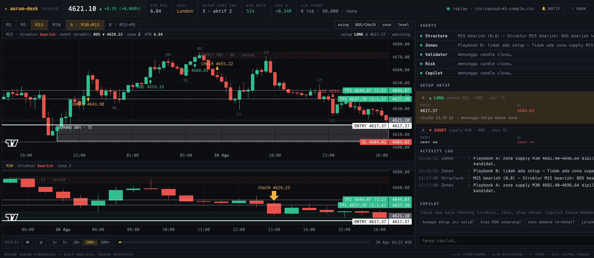
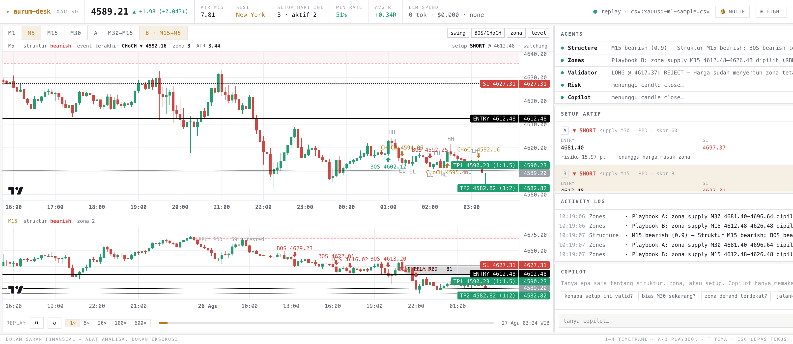

# aurum-desk

Meja analisa pribadi untuk **XAUUSD** di M1 / M5 / M15 / M30: chart ala TradingView (Lightweight Charts v5),
engine strategi deterministik (market structure + supply/demand + validasi price-action), dan **swarm agen AI**
yang berjalan di setiap candle close, menggambar setup di chart (entry, SL, TP1 1:1.5, TP2 1:2), menulis
alasannya ke activity log, dan bisa diajak chat.

> **Bukan saran finansial — alat analisa, bukan eksekusi.** Aplikasi ini tidak pernah terhubung ke broker dan tidak
> pernah mengirim order. Semua level dihitung oleh kode deterministik; LLM hanya menalar, memvalidasi, memberi
> peringkat, dan menjelaskan — tidak pernah mengarang harga.

## Tampilan

Chart multi-timeframe (M5 + M15) dengan zona supply/demand, label struktur (BOS/CHoCH, HH/HL/LH/LL), dan garis setup
Entry / SL / TP1 / TP2 — dengan panel agen, setup aktif, activity log, dan copilot di sisi kanan. Gambar di bawah
diambil dari mode replay data XAUUSD riil.

**Tema gelap**



**Tema terang**



## Jalankan tanpa API key (replay data riil)

Butuh Node ≥ 20.19, pnpm (via corepack), dan Docker (untuk Postgres/TimescaleDB).

```bash
corepack enable && pnpm install
cp .env.example .env               # default: MARKET_DATA_PROVIDER=replay, LLM_PROVIDER=none
pnpm db:up && pnpm db:migrate      # Postgres 16 + TimescaleDB, hypertable + continuous aggregates
pnpm dev                           # server http://localhost:4000 · web http://localhost:3000
```

Replay memutar `data/xauusd-m1-sample.csv` — 41.125 candle M1 **riil** dari Dukascopy (Agustus–Oktober 2026) — pada
kecepatan `REPLAY_SPEED` (default 20×; kontrol ▶ ⏸ 1×/5×/20×/100×/600× ada di bawah chart). Tanpa Docker pun desk
tetap jalan (mode memory-only; setup/log tidak disimpan).

Mock data **tidak pernah** dipakai diam-diam. `MARKET_DATA_PROVIDER=mock` hanya untuk unit test / dev eksplisit dan
menampilkan badge merah **MOCK DATA** di header.

## Menambah data live dan LLM

| Yang diinginkan | Isi di `.env` |
|---|---|
| Harga live XAU/USD (Twelve Data, 1min, polling) | `MARKET_DATA_PROVIDER=twelvedata` + `TWELVEDATA_API_KEY=…` |
| Agen & copilot dengan Claude | `LLM_PROVIDER=anthropic` + `ANTHROPIC_API_KEY=…` (`ANTHROPIC_MODEL` default `claude-opus-5-5`) |
| … dengan OpenAI | `LLM_PROVIDER=openai` + `OPENAI_API_KEY=…` (`OPENAI_MODEL` default `gpt-5-mini`) |
| … dengan model lokal | `LLM_PROVIDER=ollama` + `OLLAMA_BASE_URL`, `OLLAMA_MODEL` (model dengan dukungan tools, mis. `qwen3:8b`) |
| Alert Telegram (setup valid/triggered/TP/SL, ingest gagal/basi) | `TELEGRAM_BOT_TOKEN`, `TELEGRAM_CHAT_ID` |
| Saran ukuran posisi agen Risk | `RISK_PERCENT`, `ACCOUNT_SIZE` |

Tidak ada perubahan kode yang diperlukan — hanya env. Tanpa LLM key, agen tetap bekerja dengan penjelasan
rule-based (dan mengatakannya). Token LLM dibatasi per siklus (`LLM_MAX_TOKENS_PER_CYCLE`) dan per hari
(`LLM_DAILY_TOKEN_BUDGET`); pemakaian tampil di header sebagai **LLM spend**.

## Data historis (`apps/ingest`)

Satu container/proses terpisah yang hanya menulis tabel candle. Engine membaca Postgres; web tidak pernah menyentuhnya.

```bash
pnpm ingest backfill --from 2024-01-01      # Dukascopy (resmi, gratis), chunk mingguan, resumable & idempotent
pnpm ingest incremental                      # tambah data terbaru (overlap 2 jam, upsert)
pnpm ingest gaps --days 30                   # laporan menit yang hilang vs kalender pasar (weekend & break harian bukan gap)
pnpm ingest reconcile --days 30              # isi gap + refresh continuous aggregates
pnpm ingest import-mt5 export.csv --tz-offset 180   # harga broker dari ekspor MetaTrader 5 (waktu server → UTC)
pnpm ingest export-csv --from … --to … --out data/xauusd-m1-sample.csv
pnpm ingest serve                            # cron: incremental */5, reconcile 02:00 UTC, cek data basi tiap 15 menit
```

- `candles_m1` adalah hypertable; **M5/M15/M30 adalah continuous aggregates** Timescale — tidak pernah diisi manual.
- Validasi zod di batas adapter: OHLC konsisten, menit tepat, tidak di masa depan; lompatan > 5×ATR dicatat di tabel
  `anomalies`, bukan dibuang. `raw_ingest` menyimpan respons provider apa adanya.
- `ENGINE_CANDLE_SOURCE` memilih `source` yang dibaca engine (`dukascopy|twelvedata|mt5csv|tradingview`).

### Adapter TradingView (tidak resmi, nonaktif)

`apps/ingest/src/providers/tradingview.ts` memakai websocket **tidak terdokumentasi** milik TradingView (protokol yang
dipakai `tvDatafeed`). Ini **melanggar Terms of Service TradingView**, bisa putus kapan saja, dan sepenuhnya risiko Anda
sendiri. Adapter ini terisolasi, nonaktif secara default, gagal dengan log + alert (tidak pernah menjatuhkan service),
dan ditolak jika menjadi satu-satunya sumber. Aktifkan hanya dengan `TRADINGVIEW_ENABLED=true` dan tetap dampingi
dengan sumber resmi.

## Agen & copilot

| Agen | Pemicu | Keluaran |
|---|---|---|
| Structure | close M15 & M30 | narasi bias + confidence (BOS/CHoCH, HH/HL/LH/LL) |
| Zones | close M5/M15/M30 (setelah playbook) | alasan pemilihan zona per playbook; jika LLM tidak setuju dengan engine, ditandai ⚠ (engine tetap dipakai) |
| Validator | harga berada di dalam zona setup | valid/reject + alasan dari pola pressure |
| Risk | setup menjadi valid | cek RR 1:1.5/1:2, SL di luar zona, jarak risiko vs ATR, saran lot untuk `RISK_PERCENT`/`ACCOUNT_SIZE` |
| Copilot | pesan chat | jawaban Bahasa Indonesia yang di-stream; tools `getCandles`, `getStructure`, `getZones`, `getSetups`, `explainSetup`, `runPlaybook`, `drawAnnotation` (hanya level yang dikenal engine) |

Playbook A: bias + zona di **M30**, entry/validasi di **M15**. Playbook B: bias + zona di **M15**, entry di **M5**.
Setup berpindah status `watching → valid → triggered → tp1 → tp2 | stopped | invalidated | expired` dari engine
(setelah TP1 stop dipindah ke breakeven; R jurnal: TP2 = +1.75R, TP1 lalu BE = +0.75R, SL = −1R).

## Pintasan keyboard

`1` `2` `3` `4` timeframe M1/M5/M15/M30 · `A` / `B` playbook · `T` tema gelap/terang · `Esc` lepas fokus setup.
Klik kartu setup → chart fokus ke zona-nya; arahkan kursor ke zona → rincian skor.

Garis entry **hitam di tema terang, putih di tema gelap** (SL putus-putus, TP titik-titik), setiap garis berlabel harga
2 desimal; zona terpilih digambar sebagai kotak dengan border hitam/putih dan isi 14 %.

## Struktur repo

```
apps/web      Next.js 15 + React 19 + Tailwind 4 + Zustand + lightweight-charts v5
apps/server   Fastify + WebSocket: feed, engine runner, agen, copilot, REST
apps/ingest   pipeline data → Postgres/Timescale (Dukascopy, Twelve Data, MT5 CSV, TradingView*)
packages/engine   @aurum/engine — engine strategi murni (tanpa I/O), ≥ 80 % coverage
packages/llm      @aurum/llm    — LLMProvider: Anthropic / OpenAI / Ollama / none
packages/shared   @aurum/shared — skema zod & tipe (Candle, Setup, AgentEvent, protokol WS)
packages/db       @aurum/db     — Drizzle schema, migrasi, DDL Timescale, repository
data/             sampel M1 riil untuk replay + fixture
```

## Perintah

```bash
pnpm dev · pnpm test · pnpm typecheck · pnpm test:coverage
pnpm e2e                      # Playwright: replay → setup muncul → klik kartu → chat "kenapa setup ini valid?"
docker compose --profile full up --build   # db + ingest + server + web
```

Zona waktu: disimpan UTC, ditampilkan WIB (Asia/Jakarta). Kalender pasar mengikuti waktu New York (buka Minggu 18:00 ET,
tutup Jumat 17:00 ET, break harian 17:00–18:00 ET).
